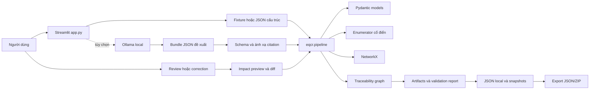

# 03 — Kiến trúc và luồng dữ liệu

## Các thành phần hiện có

- app.py: bốn tab Streamlit, session, fixture/upload, Ollama, run/review, impact preview, snapshots và downloads.
- eqcr/models.py: schema Pydantic chặt; từ chối trường ngoài schema.
- eqcr/fixture.py: PETCLINIC-MINI-WHAT-IF; requirements minh họa/precomputed, không lấy từ source code PetClinic.
- eqcr/ollama.py: HTTP local tại OLLAMA_HOST hoặc 127.0.0.1:11434; prompt có version, JSON schema, ánh xạ FR ID sang source ID/span.
- eqcr/pipeline.py: mười bước, liệt kê Bell partitions, tính cost/conflicts, tạo quanta/interactions/quality artifacts và assertions.
- eqcr/project_io.py: giải mã UTF-8/JSON package và trả lỗi đầu vào rõ ràng.
- eqcr/traceability.py: dựng graph provenance/dependency, giữ nguồn ngoài scope và unresolved links tường minh; kiểm tra cấu trúc chứ không đánh giá nghĩa.
- eqcr/impact.py: dependency graph và closure bắc cầu cho preview.
- eqcr/review.py: decisions/revisions, chỉnh sửa, replay, invalidation và diff.
- eqcr/storage.py: JSON theo run, snapshots phiên bản và ZIP trong bộ nhớ.
- tests/test_pipeline.py: regression suite; tests không cần gọi model/network thật.

## “Quantum” trong MVP nghĩa là gì?

Đây là tên của một nhóm responsibility ứng viên. Tìm kiếm phân hoạch dùng Python cổ điển và exhaustive; không có qubits hay quantum solver. Với sáu phần tử, Bell(6)=203 phân hoạch.

## Dòng xử lý

1. UI chọn fixture hoặc kiểm tra package JSON.
2. Ollama tùy chọn nhận context/requirements/workflow/scenarios và trả JSON.
3. Ứng dụng kiểm tra schema/IDs rồi lấy source spans từ input.
4. Candidate pipeline dùng responsibilities/constraints được khai báo, liệt kê partitions và tạo artifacts dẫn xuất; traceability graph ghi các liên kết và status đi kèm.
5. Người review xem xét, preview impact, áp dụng correction và chạy lại; graph được cập nhật, storage lưu phiên bản.
6. Tải JSON/ZIP qua ứng dụng local, bao gồm traceability artifact.

Ollama không chạy validators và không xác nhận ý nghĩa. Chế độ offline chạy khi thiếu daemon/model. MVP không phải dịch vụ đa người dùng.

## Chạy và lưu dữ liệu

Cần Python 3.11+ và packages trong requirements.txt. Lệnh streamlit run app.py chạy UI. storage.ARTIFACT_ROOT trỏ tới runs/; mỗi run có JSON và snapshots/. .gitignore loại runs thô/cache khỏi Git.
